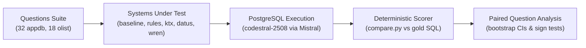

# dbeval

> Which data-agent context layer works best on *your* database? A neutral head-to-head evaluation over Postgres.

📖 **Final Evaluation Report:** Read the full findings, statistical tests, and failure analyses in [**`results/REPORT.md`**](results/REPORT.md).  
⚖️ **License:** Licensed under the [MIT License](LICENSE).

---

### TL;DR

1. **Rules are the primary lever:** Encoding business rules lifts text-to-SQL accuracy from 4.0 / 32 (12.5%) to 28.0 / 32 (87.5%) on SaaS edge cases (`appdb`), but structuring them inside semantic layer tools lands within 0 to 3 questions of pasting the rules directly into the prompt (`baseline_rules`).
2. **Tool structures show no statistical advantage:** Across 50 questions evaluated over 3 repetitions (1,450 runs), all reviewed tools (`wren_reviewed` 28.0 / 32, `ktx_reviewed` 26.33 / 32, `datus_reviewed` 26.33 / 32, `datus_reviewed_defonly` 25.33 / 32) tie or sit slightly below raw prompt rules (all 95% bootstrap confidence intervals span zero).
3. **Decision: PIVOT.** Future work shifts from benchmarking static semantic layer formats to **automated rule capture, induction, and verification** directly from databases and query logs.



---

### Head-to-Head Benchmark Results

All metrics reflect majority scoring across 3 repetitions per question evaluated with `codestral-2508` via Mistral AI.

| System | `appdb` (32 Qs) | `appdb` Acc | `olist` (18 Qs) | `olist` Acc | Net vs. `baseline_rules` |
|---|:---:|:---:|:---:|:---:|:---:|
| **`baseline`** (raw schema + samples) | 4.0 / 32 | 12.5% | 13.0 / 18 | 72.2% | -24.0 Qs ($p < 0.001$) |
| **`baseline_rules`** (prompt rules) | **28.0 / 32** | **87.5%** | **15.0 / 18** | **83.3%** | — (reference) |
| **`wren_reviewed`** *(with engine rewrite)* | **28.0 / 32** | **87.5%** | 14.0 / 18 | 77.8% | +0.0 Qs ($p = 1.000$) |
| **`ktx_reviewed`** *(YAML metrics & desc)* | 26.33 / 32 | 82.3% | 15.0 / 18 | 83.3% | -1.67 Qs ($p = 0.375$) |
| **`datus_reviewed`** *(with free-text drop-in)* | 26.33 / 32 | 82.3% | **16.33 / 18** | **90.7%** | -1.67 Qs ($p = 0.688$) |
| **`datus_reviewed_defonly`** *(DDL comments only)* | 25.33 / 32 | 79.2% | 14.67 / 18 | 81.5% | -2.67 Qs ($p = 0.289$) |

---

### Upstream Issues Filed & Proposed Fixes

During benchmark execution and engine audits, `dbeval` surfaced two failure modes in upstream repositories. Issues were filed and fixes were proposed on forks (both open, not merged):

1. **[`kaelio/ktx#377`](https://github.com/kaelio/ktx/issues/377)** — *Silent Enrichment Failure & Cache Poisoning*:
   When external LLM enrichment failed (e.g. gateway 404 from `/language-model` or rate limits), `@kaelio/ktx` silently reported exit code 0, cached empty/null results in `descriptions.json` and SQLite `scan:descriptions`, and bypassed per-table resume in `ktx 0.16.0`. Proposed fix on fork ([`Kaelio/ktx#378`](https://github.com/Kaelio/ktx/pull/378) / [`meet987654/ktx:fix/description-enrichment-silent-failure`](https://github.com/meet987654/ktx/tree/fix/description-enrichment-silent-failure), open, not merged) adds total failure detection, truthful exit status reporting, and safe resume handling.
2. **[`Datus-ai/Datus-agent#1542`](https://github.com/Datus-ai/Datus-agent/issues/1542)** — *Foreign Key Omission in Reconstructed Table DDL*:
   `datus-postgresql` reconstructed table DDL by restricting constraints to `contype IN ('p', 'u')`, omitting all foreign keys and forcing LLMs to guess join keys. Proposed fix on fork ([`Datus-ai/datus-db-adapters#177`](https://github.com/Datus-ai/datus-db-adapters/pull/177) / [`meet987654/datus-db-adapters:fix/postgresql-ddl-foreign-keys`](https://github.com/meet987654/datus-db-adapters/tree/fix/postgresql-ddl-foreign-keys), open, not merged) expands constraint extraction to `contype IN ('p', 'u', 'f')`, adds deterministic constraint ordering, and separates unvalidated (`NOT VALID`) foreign keys into standalone `ALTER TABLE` statements.

---

## How to Reproduce

### Option 0: Instant Headline Analysis (Zero Setup — No Docker, No API Key)

You can reproduce the headline question-level benchmark analysis directly from the committed raw results with only standard Python:

```bash
python scorer/analyze.py results/raw/suite_results_all.csv --ties half
```

**Expected Output:**

```text
# dbeval analysis (question-level)

Source: `results/raw/suite_results_all.csv`. Rows dropped for infrastructure errors: 0.

## appdb  (32 questions)

| system | questions passed | accuracy | flaky questions* |
|---|---|---|---|
| baseline | 4/32 | 12.5% | 0 |
| baseline_rules | 28/32 | 87.5% | 2 |
| datus | 5/32 | 15.6% | 0 |
| datus_reviewed | 26.3333/32 | 82.3% | 3 |
| datus_reviewed_defonly | 25.3333/32 | 79.2% | 4 |
| ktx | 4/32 | 12.5% | 0 |
| ktx_reviewed | 26.3333/32 | 82.3% | 3 |
| schema_only | 3/32 | 9.4% | 0 |
| schema_true_joins | 4/32 | 12.5% | 0 |
| wren | 4/32 | 12.5% | 0 |
| wren_reviewed | 28/32 | 87.5% | 3 |
| wren_reviewed_unresolved | 25/32 | 78.1% | 8 |

## olist  (18 questions)

| system | questions passed | accuracy | flaky questions* |
|---|---|---|---|
| baseline | 13/18 | 72.2% | 0 |
| baseline_rules | 15/18 | 83.3% | 0 |
| datus | 13/18 | 72.2% | 2 |
| datus_reviewed | 16.3333/18 | 90.7% | 1 |
| datus_reviewed_defonly | 14.6667/18 | 81.5% | 1 |
| ktx | 14/18 | 77.8% | 0 |
| ktx_reviewed | 15/18 | 83.3% | 0 |
| schema_only | 11/18 | 61.1% | 0 |
| schema_true_joins | 12.5/18 | 69.4% | 1 |
| wren | 14/18 | 77.8% | 2 |
| wren_reviewed | 14/18 | 77.8% | 2 |
| wren_reviewed_unresolved | 13.3333/18 | 74.1% | 2 |
```

---

### Option 1: Quickstart Execution Script (Requires Docker + 1 API Key)

To spin up the PostgreSQL database, seed `appdb`, and run a live 10-question evaluation comparing `baseline` vs `baseline_rules`:

```bash
# 1. Install dependencies
pip install -r requirements.txt

# 2. Configure .env with your LLM API key (e.g. Mistral, Anthropic, or OpenAI)
cp .env.example .env

# 3. Run quickstart
python scripts/quickstart.py
```

*Expected Result:* `baseline` scores low (failing on SaaS traps such as test accounts, soft deletes, and cents conversion), while `baseline_rules` scores high as prompt rules clarify those edge cases.

---

### Option 2: Full Benchmark Reproduction

```bash
# 1. Start PostgreSQL container
docker compose up -d

# 2. Seed synthetic SaaS database
python db/seed_appdb.py

# 3. Verify comparison engine
python scorer/test_compare.py

# 4. Run full 3-repetition benchmark across all systems
python scorer/run_suite.py --system everything --db both --runs 3

# 5. Compute paired statistical analysis
python scorer/analyze.py results/raw/suite_results_all.csv --baseline baseline --ties half --out results/ANALYSIS_REVIEWED.md
python scorer/analyze.py results/raw/suite_results_all.csv --baseline baseline_rules --ties half --out results/ANALYSIS_VS_RULES.md
```

---

## Methodological Limitations

When interpreting these results, several constraints must be noted:

1. **AI-Assisted Reviewer:** Semantic layers (ktx YAML, Datus drop-in, Wren MDL) were reviewed and authored during timed sessions with an AI agent following `docs/business_rules.md`, not an experienced human analytics engineer writing handwritten production definitions over weeks.
2. **Small Question Sets:** The evaluation suite consists of 50 scored questions (32 on `appdb`, 18 on `olist`). With 32 questions, one question equals 3.1 percentage points; small differences (under ~3 questions) are within sampling noise.
3. **Shared Source Upper Bound:** The gold SQL answer keys and the reviewed semantic layers were both constructed from the same specifications document (`docs/business_rules.md`). The benchmark evaluates how well tools *carry* specified rules, not whether they can *discover* unwritten business logic.
4. **Post-Hoc Rules Revision (Rules v2):** Rules v2 clarified date windows (half-open intervals), cash-basis refund netting, and plan tier definitions after inspecting baseline failure modes. All systems were re-evaluated against rules v2.
5. **Excluded Olist Questions:** Three Olist questions (`olist-012`, `olist-016`, `olist-017`) were excluded from the scored suite due to unresolvable schema ambiguities in the raw Brazilian e-commerce dataset, leaving 18 scored questions.

---

## Overview of Evaluated Systems

All systems under test run against the exact same LLM (**`codestral-2508`** via Mistral AI) with read-only database credentials (`reader`).

| System | Tool Version | Layer Artifact Location | Layer Contents | Execution Modality |
|---|---|---|---|---|
| **Baseline** | Native Python | Direct DB introspection | Tables, columns, PKs, 3 sample values / col | Raw schema + samples in prompt |
| **ktx** | `@kaelio/ktx@0.16.0` | `layers/ktx/<db>/semantic-layer/` | Table schemas + Inferred foreign keys (YAML) | Schema + Inferred joins in prompt |
| **Datus (stored context)** | `datus-agent 0.4.3` | `layers/datus/<db>/` | LanceDB table DDL, PKs, sample rows | RAG-retrieved definitions & samples in prompt |
| **Wren Engine** | `wren-engine 0.6.0` | `layers/wren/<db>/target/mdl.json` | MDL compiled models, columns, declared relationships | Compiled MDL schemas & relationships in prompt |

---

## Development Milestones & Status Log

- [x] **Day 1: Baseline & Second Database:** Seeded `appdb` with real-world SaaS edge cases. Built `runners/baseline.py`.
- [x] **Day 2: Business Rules & Question Suites:** Defined answer-key rules in `docs/business_rules.md`. Created dual-oracle validation harness (`scorer/validate_gold.py`).
- [x] **Day 3: Out-of-the-Box Layer Generation:** Built and audited semantic layers for ktx, Datus, and Wren Engine. Benchmarked ktx inferred join quality (100% precision). Exported Datus LanceDB metadata to JSON and Parquet.
- [x] **Question Suite Frozen (`suite-v1`):** 53 validated questions (34 `appdb`, 19 `olist`, consisting of 50 scored and 3 ambiguous). Tagged `suite-v1`.
- [x] **Day 4: Test Harness & 3x Full Evaluation:** Built runners and `scorer/run_suite.py`. Completed 3 full evaluation passes with `codestral-2508` across all 4 systems on both databases.
- [x] **Day 5: Timed Review, Execution Fixes & Final Report:** Encoded business rules across ktx, Wren Engine, and Datus. Fixed Wren engine SQL rewriting pass to resolve calculated fields. Isolated the Datus free-text drop-in effect. Completed 3 repetitions (1,450 total runs) and generated paired statistical reports (`scorer/analyze.py`) and failure attribution (`scorer/label_failures.py`). Tagged `study-v1` and `study-v1.3`.
- [x] **Post-Study Tool Audits & Upstream Fixes:** Identified silent enrichment failure in ktx (filed `kaelio/ktx#377`, proposed fix `kaelio/ktx#378`) and missing foreign keys in Datus (filed `Datus-ai/Datus-agent#1542`, proposed fix `Datus-ai/datus-db-adapters#177`).

---

## License

This project is licensed under the [MIT License](LICENSE).
