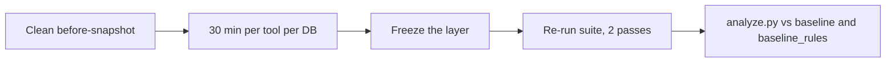

# Day 5 protocol: the timed review

## The question

Pasting `docs/business_rules.md` into the prompt (`baseline_rules`) already lifts `appdb` from 5/32 to 19/32.
So Day 5 does not ask "can a tool use rules?". It asks:

**Can a tool's structure (views, calculated fields, metrics) do better than just pasting the rules?**

If a tool only stores prose descriptions, it will probably match `baseline_rules` at best.
If it can hold executable definitions, it might beat it, because the SQL is already written correctly.

## Step 0: get a clean "before" (not timed)

Runner templates changed after the first benchmark, so the old numbers are not comparable.

1. `git tag rules-v1` on the commit that has the old rules, then commit `docs/business_rules.md` (version 2).
2. Run all systems again with the final runners, 2 passes, both databases:
   `baseline`, `schema_only`, `schema_true_joins`, `baseline_rules` (now with rules v2), `ktx`, `wren`, `datus`.
3. Keep the old results file. Do not overwrite it.
4. Commit the new results.

## Step 1: rules for the person doing the review

- The same person (or the same agent with the same instructions) reviews every tool.
- You MAY read `docs/business_rules.md` and each tool's documentation.
- You MUST NOT open `questions/`, `results/`, any gold SQL, or any failure list while encoding.
  Otherwise you are tuning the layer to the test.
- Reading a tool's docs before the timer starts is allowed, up to 15 minutes per tool. Write the minutes down.
- Then a **30 minute timer per tool per database**. When it ends, stop. Whatever is not finished is "ran out of time".
- Do not edit a layer after you freeze it.

## Step 2: what to encode, in this order

Do the biggest-impact rules first, so every tool gets the same chance to fit them in 30 minutes.

**appdb**
1. Real account: `is_test = false` and `deleted_at IS NULL` (rules 1, 2)
2. Current plan is `plan_tier`, never `plan` (rule 3)
3. USD amount from cents with numeric division and `fx_rates` (rule 4)
4. Gross revenue, refunds, net revenue as two separate period sums (rules 5, 6, 7)
5. Active subscription (rule 8)
6. Churn, with upgrades excluded (rule 9)
7. Active user, paying customer, revenue per paying customer, churned account (rules 10 to 13)
8. Half-open date windows (rule 14)

**olist**
1. Customer means `customer_unique_id`
2. Sales and "sold" exclude canceled and unavailable orders
3. Order payment value is the sum of payment rows
4. Delivered, late, delivery time
5. English category name, with the Portuguese name as the fallback
6. Latest review per order
7. Dates stored as text must be cast to timestamps

## Step 3: how to encode

Use the most structured form the tool supports, in this preference order:

1. A **view** with the filter already inside it (for example a `real_accounts` view)
2. A **calculated field** with the exact SQL expression
3. A **metric** with the exact SQL expression
4. A column or table **description**, only if nothing structured is available

Write the exact SQL, do not paraphrase it.

## Step 4: log every rule in `notes/day5_review_log.md`

One row per rule, per tool, per database:

| rule | tool | db | form used (view / calculated / metric / description / not possible / ran out of time) | minutes |
|---|---|---|---|---|

Also log: the docs-reading minutes, the total minutes, and the tool version.

## Step 5: freeze and re-run

1. Copy the finished layer to `layers/<tool>/<db>_reviewed/` and commit it.
2. Run the suite for the reviewed `ktx`, `wren` and `datus` systems, 2 passes. Use the same runner and prompt template as before.
3. Record `context_tokens` for each question.
4. Run `python scorer/analyze.py <results.csv> --out results/ANALYSIS_REVIEWED.md`.
5. Run `python scorer/label_failures.py <results.csv> --out results/FAILURES_REVIEWED.md` (count per question, not per run).

## Pre-registered expectations (write these down before you look at results)

- **H1:** a tool that holds executable definitions beats `baseline_rules` on the questions about date windows, currency and net revenue.
- **H2:** a tool that only holds prose matches `baseline_rules`, not more.
- **H3:** a rushed human review leaves some rules unencoded, so a reviewed tool scores below `baseline_rules`.

A difference only counts if the paired bootstrap interval excludes 0.
On `appdb`, one question is 3.1 points. On `olist`, one question is 5.6 points.

## How to read the outcome

| What you see | What it means |
|---|---|
| Reviewed tools clearly differ from each other | A neutral comparison has value. Lean towards "go". |
| Reviewed tools all land near `baseline_rules` | The rules are the lever, not the tool. Lean towards a pivot to rule capture and verification. |
| Reviewed tools land below `baseline_rules` | Encoding costs more than pasting. Report the minutes and the rules that did not fit. |

## Known limits (put these in the report)

- One reviewer, small question sets (32 and 18).
- The rules file is also what the gold answers came from, so `baseline_rules` is an upper bound, not a realistic case.
- ktx enrichment never ran (gateway mismatch), and Wren is the engine, not the full Wren AI product.
- Datus is run as stored context, not as its agent.
- Three Olist questions (`olist-012`, `016`, `017`) were excluded from suite-v1.
