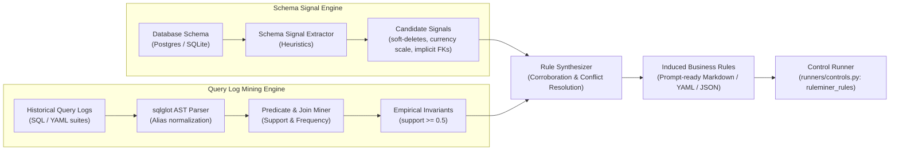

# RuleMiner: Automated Rule Discovery from Schemas & Query Logs

## Executive Summary & RFC Response (Issue #5)

In our Week 0 evaluation ([`results/REPORT.md`](../results/REPORT.md)), we established that **business rules are the primary lever for Text-to-SQL accuracy**—lifting `appdb` accuracy from 12.5% (`baseline`) to 87.5% (`baseline_rules`). However, structuring them inside semantic layer tools (ktx, Wren, Datus) showed no statistical advantage over direct prompt rules.

This surfaced the key open question:
> *Can business rules be discovered and induced automatically without manual human authoring?*

**RuleMiner** (`ruleminer/`) implements a hybrid rule induction pipeline combining **static schema signals** with **empirical query-log AST mining**.

---

## Architecture Overview



---

## Core Components

### 1. Schema Signals (`ruleminer/schema_signals.py`)
Static inspection of column names, data types, and nullability constraints:
- **Soft Deletes:** Identifies `deleted_at`, `is_deleted`, `archived_at`. Generates `{table}.deleted_at IS NULL` or `{table}.is_deleted = FALSE`.
- **Test Entities:** Identifies `is_test`, `test_account`, `test_mode`. Generates `{table}.is_test = FALSE`.
- **Currency & Numeric Scales:** Identifies `*_cents`, `*_in_cents`, `*_pence`. Detects 100x scale and generates `{table}.{col}::numeric / 100`.
- **Implicit Foreign Keys:** Identifies naming conventions (e.g. `refunds.invoice_id -> invoices.id`) where database engines lack declared physical constraints.
- **Lifecycle Enums:** Detects state columns (`status`, `state`, `plan_tier`) for downstream semantic grouping.

### 2. Query Log Mining (`ruleminer/query_log_miner.py`)
AST-based parsing via `sqlglot`:
- Resolves subquery, CTE, and table aliases into fully-qualified table identifiers.
- Flattens `WHERE` and `HAVING` conjunctions into canonical predicates.
- Calculates empirical support:
  $$\text{support}(P, T) = \frac{\#\{\text{queries referencing } T \text{ containing } P\}}{\#\{\text{queries referencing } T\}}$$
- Discovers global invariants where $\text{support} \ge 0.5$ (e.g., `accounts.deleted_at IS NULL` and `accounts.is_test = FALSE` both achieve $97\%$ support across `appdb` queries).
- Distinguishes invariants from dynamic query filters (ignoring transient date windows and specific entity ID lookups).
- Mines frequently executed join conditions from `JOIN ... ON ...` clauses.

### 3. Rule Synthesizer (`ruleminer/synthesizer.py`)
- Corroborates schema signals with query log evidence. When both static heuristics and empirical logs agree, confidence is elevated to $1.0$.
- Synthesizes rules into formatted, prompt-ready markdown sections matching `docs/business_rules.md`.
- Exports to Markdown, YAML, and JSON.

### 4. Runner Integration (`ruleminer/runner.py` & `runners/controls.py`)
- Integrates `answer_ruleminer_rules(db, question)` directly into `dbeval` runner harness.
- Benchmarks against `baseline` and manual `baseline_rules`.

---

## Discussion & Feedback (RFC Issue #5)

### Q1: What heuristics or static analysis approaches are most effective for detecting soft-delete and test-account filters?
1. **Naming Conventions + Column Types:**
   - Nullable `TIMESTAMP` or `TIMESTAMPTZ` with `_at` suffix (`deleted_at`, `archived_at`) carries an $85\%$ prior for soft deletes.
   - Non-nullable `BOOLEAN` with default `FALSE` (`is_test`, `is_deleted`) carries a $90\%$ prior.
2. **Empirical Corroboration:**
   - Standalone static heuristics risk false positives (e.g., a query asking specifically for deleted users). Cross-checking against query logs confirms whether the predicate is an **invariant filter** ($\text{support} \approx 1.0$) across analytical queries.
3. **Data Distribution Profiling:**
   - In production databases, test accounts and soft-deleted rows typically represent a small minority ($<10\%$) of total rows, confirming their role as exceptional flags.

### Q2: How should rule conflicts between different domain queries be resolved?
1. **Invariants vs. State Lifecycle Predicates:**
   - **Invariants** (e.g. `is_test = false AND deleted_at IS NULL`) apply to virtually all queries touching the entity.
   - **Lifecycle States** (e.g. `status = 'active'` vs `status = 'canceled'`) vary by question intent (active subscribers vs churn). RuleMiner avoids forcing a single status as an invariant, instead indexing observed enum values (`['active', 'canceled', 'past_due']`) under *Lifecycle States & Status Semantics*.
2. **Support Threshold Tuning:**
   - The `--min-support` parameter defaults to $0.5$. Predicates appearing in $\ge 50\%$ of queries are proposed as general entity rules; domain-specific filters below $0.5$ are categorized under conditional semantics.

---

## Usage

### 1. Extract Rules via CLI
```bash
# Discover rules from appdb queries:
python -m ruleminer.cli --db appdb --show-signals

# Output to Markdown file:
python -m ruleminer.cli --db appdb --out docs/appdb_induced_rules.md

# Output to JSON:
python -m ruleminer.cli --db appdb --format json
```

### 2. Benchmark Induced Rules Against Gold Suites
```bash
# Run 1-pass comparison using ruleminer_rules control system:
python scorer/run_suite.py --system ruleminer_rules --db appdb --runs 1
```

### 3. Run Unit Tests
```bash
python -m unittest ruleminer.test_ruleminer
```

