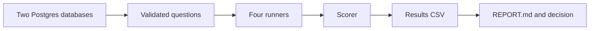

# dbeval: Week 0 Guide

Put this file in the repo as `docs/WEEK0_GUIDE.md` and tick things off as you go.

## What you are doing this week

You are running a fair race between four ways of letting an AI answer questions about a database:

1. A plain LLM that only sees the table definitions (the baseline)
2. ktx
3. Datus
4. Wren

You run the same questions on the same databases with the same model. Then you count who got the answer right.

At the end of the week you will know two things:

- Do the tools score differently enough that a neutral comparison is useful?
- Does the ranking change from one database to another?

Customer calls and outreach are **not** part of this guide. They come later.



---

## 1. What the repo should have (and nothing more)

```
dbeval/
  README.md              pitch, status, decision rule
  .gitignore             data/, .env, __pycache__/
  .env.example           DB urls, LLM_MODEL, API keys (names only)
  docker-compose.yml     local Postgres
  docs/
    WEEK0_GUIDE.md       this file
  db/
    init.sql             creates databases and the read-only role
    load_olist.py        loads the Olist CSVs
    seed_appdb.py        builds the fake SaaS database
  data/                  raw CSVs (gitignored)
  questions/
    olist.yaml           validated questions
    appdb.yaml
    disputed/            questions where gold answers disagreed
  runners/
    baseline.py          the plain-LLM runner
    ktx_run.py           added on day 4
    datus_run.py         added on day 4
    wren_run.py          added on day 4
  scorer/
    compare.py           compares two result sets
    run_suite.py         runs every question, writes the CSV
  notes/
    ktx.md               setup log: time taken, steps, problems
    datus.md
    wren.md
  results/
    raw/                 one CSV per run
    REPORT.md            the write-up (day 7)
```

**Do not add yet:** a web UI, a GitHub Action, a pip package, a hosted version, or other databases. Those only matter if the week-0 result says "go".

---

## 2. Day 0 (tonight, about 90 minutes)

### Step 1: Make the repo
- [x] 1. Create a public GitHub repo named `dbeval`.
- [x] 2. Add the folders from section 1 (empty folders need a `.gitkeep` file).
- [x] 3. Write `README.md` with three things: the one-line pitch, the decision rule (section 10), and a status line.

One-line pitch to paste:

> Which data-agent context layer works best on *your* database? A neutral head-to-head, starting with Postgres.

### Step 2: Start Postgres
Create `docker-compose.yml`:

```yaml
services:
  db:
    image: postgres:16
    environment:
      POSTGRES_USER: postgres
      POSTGRES_PASSWORD: postgres
    ports:
      - "5433:5432"
    volumes:
      - pgdata:/var/lib/postgresql/data
volumes:
  pgdata:
```

Run `docker compose up -d`. Port 5433 avoids clashing with any Postgres you already have.

### Step 3: Create the databases and a read-only user
Create `db/init.sql`:

```sql
CREATE DATABASE olist;
CREATE DATABASE appdb;
CREATE ROLE reader LOGIN PASSWORD 'reader';
GRANT CONNECT ON DATABASE olist TO reader;
GRANT CONNECT ON DATABASE appdb TO reader;
```

Run it, then run this in **each** database (connect with `\c olist`, then `\c appdb`):

```sql
GRANT USAGE ON SCHEMA public TO reader;
GRANT SELECT ON ALL TABLES IN SCHEMA public TO reader;
ALTER DEFAULT PRIVILEGES IN SCHEMA public GRANT SELECT ON TABLES TO reader;
```

Every tool must connect as `reader`. That keeps the comparison fair and safe.

### Step 4: Check what each tool can do
- [x] Check ktx, Datus and Wren docs/README for Postgres, headless/MCP execution, and LLM providers (recorded in `notes/<tool>.md`).
- [ ] Record setup times and first impressions as each tool is installed.

### Step 5: Load the Olist database
1. Download the Olist dataset from Kaggle (a free account is needed) and put the CSVs in `data/`.
2. Write `db/load_olist.py`. It loops over the CSV files, reads each with pandas, and writes it to the `olist` database with `to_sql`. Name each table from its file name, for example `olist_orders_dataset.csv` becomes `orders`.
3. Run it, then check the row counts with `SELECT count(*) FROM orders;`.

Note: loading CSVs this way creates tables without foreign keys. That is realistic for a messy database, so leave it and mention it in the report.

### Step 6: Look at ktx once
Install ktx and run its setup against `olist`. Do not measure anything yet. Just see what it produces and how long it takes. Write your first impressions in `notes/ktx.md`.

**Day 0 is done when:** the repo is public, both databases exist (appdb may be empty), Olist is loaded, and each tool has a notes file.

---

## 3. Day 1: the second database and the baseline

### Step 1: Build `appdb`
This is a fake SaaS product database. It is the important one because real databases are messy. Ask an LLM to write `db/seed_appdb.py` from this spec, read the code, then run it.

Tables: `accounts`, `users`, `subscriptions`, `invoices`, `refunds`, `events`.

Put these traps in on purpose:

- `accounts.is_test` marks internal test accounts that must not count in any metric.
- `subscriptions.status` is an enum (`active`, `trialing`, `past_due`, `canceled`).
- Soft deletes: `deleted_at` on accounts and users, which must be excluded.
- Money is stored as `amount_cents` in an integer column, with a `currency` column.
- Timestamps are `timestamptz` and the business reports in a single timezone.
- Revenue means paid invoices **minus** refunds, excluding test accounts and deleted accounts.
- Churn means a subscription canceled in the period, not an account deleted.
- Two columns with confusing names, such as `plan` and `plan_tier`, where only one is current.

About 2,000 accounts and 20,000 invoices is enough.

### Step 2: Write the baseline runner
`runners/baseline.py` does five things:

1. Read the table definitions from `information_schema.columns`.
2. For each column, add 3 sample values.
3. Build one prompt: schema text plus the question, asking for a single SQL query.
4. Run the SQL as `reader`, with a timeout and a row limit.
5. Return the rows.

Choose one model for the whole project and put it in `.env` as `LLM_MODEL`. Use temperature 0. Every other tool must use the same model. If one tool cannot, pick a provider they all support.

### Step 3: Try it on 5 hand-written questions per database
Print the SQL and the rows for each. Do they look right?

**Day 1 is done when:** the baseline answers 5 questions end to end on both databases.

---

## 4. Day 2: the question suite

Aim for about 40 validated questions per database.

### Step 1: Write the questions
Mix for each database:

| Type | Count | Example |
|---|---|---|
| Simple lookups | 10 | How many orders were delivered in 2018? |
| Metric questions | 15 | What was net revenue last quarter? |
| Multi-join questions | 10 | Which sellers had the most late deliveries per category? |
| Ambiguous questions | 5 | Who are our best customers? |

Write 15 yourself, thinking like a business person. Have an LLM draft the rest, and read every one.

### Step 2: Create gold answers
For each question, get the correct SQL three independent ways:

1. You write it by hand (for your 15).
2. An LLM writes it with one prompt.
3. An LLM writes it with a different prompt, or a different model.

Run all three. If the result sets agree, save the question in `questions/<db>.yaml`. If they disagree, move it to `questions/disputed/`. Disagreement is a finding, so keep those questions.

Format:

```yaml
- id: olist-014
  category: metric
  question: What was the average delivery time in days for delivered orders?
  gold_sql: |
    SELECT ...
  status: validated
```

For ambiguous questions, the right behavior is to ask a clarifying question or to state its assumption. Mark them `category: ambiguous` and score them separately.

**Day 2 is done when:** each database has about 40 validated questions and a `disputed/` folder.

---

## 5. Day 3: build each tool's layer (out of the box)

For ktx, Datus and Wren, on both databases:

1. Start a timer.
2. Follow the docs and accept the defaults. **Make no manual edits.**
3. Write down every manual step and every problem in `notes/<tool>.md`.
4. Stop the timer when the tool can answer a first question. Record the time.

If a tool fails on a database, record why. A tool that is hard to set up is a result too.

**Day 3 is done when:** each tool has a layer on each database, or a written failure reason.

---

## 6. Day 4: runners, scorer, first full run

### Step 1: Write one runner per tool
Each runner has one function: `answer(question) -> rows`. How it works inside depends on the tool (a command, an API call, or MCP). Add the files `runners/ktx_run.py`, `runners/datus_run.py` and `runners/wren_run.py`.

### Step 2: Write the scorer
`scorer/compare.py` decides whether two answers match:

```python
def normalize(rows):
    out = []
    for row in rows:
        out.append(tuple(
            round(v, 2) if isinstance(v, float) else str(v)
            for v in row
        ))
    return sorted(out)

def same(a, b):
    return normalize(a) == normalize(b)
```

This ignores row order and tiny rounding differences. It does not forgive different column order, which is fine for now.

### Step 3: Write the suite runner
`scorer/run_suite.py` does this for every system, database and question:

1. Run the question through the runner.
2. Compare to the gold result with `same()`.
3. Record: system, database, question id, pass or fail, the SQL, error text, seconds, and token cost.
4. Write one CSV to `results/raw/`.

### Step 4: Run everything 3 times
LLMs are not perfectly steady, even at temperature 0. Three runs per question show how steady each tool is.

**Day 4 is done when:** `results/raw/` has CSVs for every system on both databases.

---

## 7. Day 5: the 30-minute human review

Now give each tool a fair chance to improve.

1. Set a 30-minute timer **per tool, per database**.
2. Open the tool's generated layer (descriptions, joins, metrics).
3. Fix what is obviously wrong: wrong join, missing metric definition, bad description.
4. Log every change in `notes/<tool>.md`.
5. Re-run the whole suite and save to `results/raw/` with `reviewed` in the file name.

The same time budget for every tool is what keeps this fair.

**Day 5 is done when:** you have before and after numbers for each tool.

---

## 8. Day 6: understand why things failed

Go through every failed question and give it one label:

- wrong join
- wrong metric definition
- wrong filter (for example, forgot to exclude test accounts)
- wrong grain (counted rows instead of customers)
- other

Add a `failure_type` column to your results. Then look at:

- Questions every system failed (probably a bad gold answer or a hard question)
- Questions only one system failed
- The disputed questions
- Any failure caused by a setup problem rather than quality. Mark these separately so you do not blame the tool unfairly.

**Day 6 is done when:** every failure has a label and you have a count per tool.

---

## 9. Day 7: the write-up

Write `results/REPORT.md` with:

1. What you tested (databases, question counts, model, tool versions)
2. The main table: accuracy per tool per database, before and after review, with counts (for example 31/40, not only 77%)
3. Failure categories per tool
4. Setup time and manual steps per tool
5. Variance between the three runs
6. Caveats: small question set, you know these tools less well than their authors, no foreign keys in Olist
7. The decision (section 10)

Keep the raw CSVs in the repo so others can check your work. Post the report once you are happy with it.

---

## 10. The decision rule

- **Go:** accuracy differs by more than about 10 points between tools on at least one database, or the ranking changes between databases.
- **Pivot:** one tool wins on everything. Then the idea shrinks to regression testing for a single layer, which is weaker.
- **Stop:** no tool beats the plain baseline by much. Then the idea that a layer helps is in doubt on your data. You still keep a solid portfolio project.

Write which one you chose, and why, at the bottom of `results/REPORT.md`.

---

## 11. Rules to keep it honest

- Same model, temperature 0, same read-only user, same timeout and row limit for every tool.
- Write down the exact version of every tool.
- Do not tune one tool more than another.
- Report counts, not just percentages. 40 questions is small.
- Run first by hand, automate second. Do not spend the week polishing the harness.
