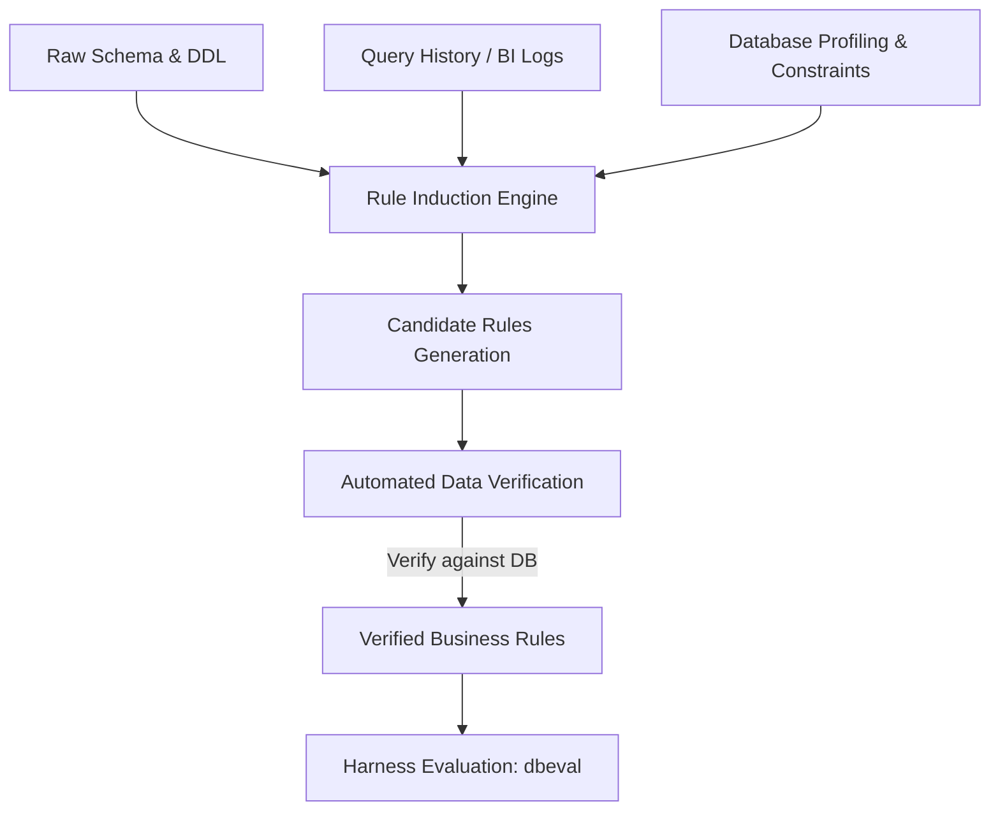

# dbeval: Week 0 Final Evaluation Report

> **Research Question:** Does structuring business rules inside semantic layer tools (ktx, Wren Engine, Datus) improve LLM SQL generation beyond simply pasting those rules directly into the prompt (`baseline_rules`)?

---

## 1. Executive Summary & Decision

### The Finding
On the rules-heavy database (`appdb`), encoding business rules inside semantic layer tools produces substantial gains over a raw schema baseline (+21 to +24 net questions passed), but **lands within 0 to 3 questions of pasting the rules into the prompt (`baseline_rules`), and none sits reliably above it**:
- `baseline`: **4.0 / 32** (12.5%)
- `baseline_rules`: **28.0 / 32** (87.5%)
- `wren_reviewed` (with engine rewrite & dialect transpile): **28.0 / 32** (87.5%) — net $+0.0$ questions vs. prompt rules (tied)
- `ktx_reviewed`: **26.33 / 32** (82.3%) — net $-1.67$ questions vs. prompt rules
- `datus_reviewed` (with free-text drop-in): **26.33 / 32** (82.3%) — net $-1.67$ questions vs. prompt rules
- `datus_reviewed_defonly` (definition comments only): **25.33 / 32** (79.2%) — net $-2.67$ questions vs. prompt rules

At our sample size (32 `appdb` questions, 18 `olist` questions), every reviewed tool is within 0 to 3 questions of `baseline_rules`, and all 95% paired bootstrap confidence intervals span zero. There is **no evidence of an advantage for tool structures over prompt rules at this sample size**.

### Decision: Pivot to Rule Capture and Verification
Per the pre-registered decision framework in [`docs/DAY5_PROTOCOL.md`](file:///c:/Users/meetp/OneDrive/Desktop/Projects/dbeval/docs/DAY5_PROTOCOL.md):
- **A "Go" on a neutral comparative scoreboard between these tools is not supported**, because no tool is reliably distinguishable from another or from `baseline_rules`.
- **A "Stop" is rejected**, because the rules effect itself is massive and unequivocal: explicit rules lift accuracy from $12.5\%$ to $87.5\%$ on `appdb`.
- **Outcome: PIVOT.** The rules are the primary lever, not the tool structure. Future work should focus on **automated rule capture, induction, and verification** (discovering candidate rules from databases and query logs) rather than benchmarking static semantic layer formats.

---

## 2. Pre-Registered Hypotheses Readout

| Hypothesis | Pre-Registered Expectation | Empirical Readout | Status |
|---|---|---|:---:|
| **H1** | Tools with executable definitions (views, calculated columns) beat `baseline_rules` on complex logic (dates, currencies, net revenue). | With native SQL expansion through Wren Engine and dialect transpilation, `wren_reviewed` scored 28.0/32 on `appdb`, matching `baseline_rules` (28.0/32; net $+0$ questions, $p = 1.000$, 95% CI $[-5.2, +5.7]$). | **No evidence of advantage at this sample size** |
| **H2** | Tools that only store prose descriptions match `baseline_rules`, not more. | `ktx_reviewed` (26.33/32) and `datus_reviewed_defonly` (25.33/32) land within 1.7 to 2.7 questions of `baseline_rules` on `appdb`, and within 0.3 questions on `olist`. | **Supported** |
| **H3** | Rushed reviews leave rules unencoded, scoring below `baseline_rules`. | When Datus was stripped of the drop-in rules document (`datus_reviewed_defonly`), accuracy dropped by 1.0 question on `appdb` and 1.67 questions on `olist`. | **Partly supported by a narrow margin** |

---

## 3. Question-Level Benchmark Scoreboard

All metrics reflect **majority scoring across 3 repetitions per question** (18 `olist` questions, 32 `appdb` questions). One question represents **3.1 percentage points on `appdb`** and **5.6 percentage points on `olist`**.

### Overall Accuracy Summary

| System | `appdb` Passed (out of 32) | `appdb` Accuracy | `olist` Passed (out of 18) | `olist` Accuracy |
|---|:---:|:---:|:---:|:---:|
| **`baseline`** (raw schema + samples) | 4.0 / 32 | 12.5% | 13.0 / 18 | 72.2% |
| **`schema_only`** (no samples) | 3.0 / 32 | 9.4% | 11.0 / 18 | 61.1% |
| **`schema_true_joins`** (FK oracle) | 4.0 / 32 | 12.5% | 12.5 / 18 | 69.4% |
| **`baseline_rules`** (raw prompt rules) | **28.0 / 32** | **87.5%** | **15.0 / 18** | **83.3%** |
| **`ktx_reviewed`** (YAML metrics & desc) | 26.33 / 32 | 82.3% | 15.0 / 18 | 83.3% |
| **`wren_reviewed`** *(with engine rewrite)* | **28.0 / 32** | **87.5%** | 14.0 / 18 | 77.8% |
| *`wren_reviewed_unresolved`* *(pre-fix)* | 25.0 / 32 | 78.1% | 13.33 / 18 | 74.1% |
| **`datus_reviewed`** *(with free-text drop-in)* | 26.33 / 32 | 82.3% | 16.33 / 18 | 90.7% |
| **`datus_reviewed_defonly`** *(DDL comments only)* | 25.33 / 32 | 79.2% | 14.67 / 18 | 81.5% |

---

### Paired Comparisons vs. `baseline`

#### `appdb` (32 questions)
| System | Fixed | Broke | Net Questions | Diff (Pts) | 95% Bootstrap CI | Sign-Test $p$ |
|---|:---:|:---:|:---:|:---:|:---:|:---:|
| **`baseline_rules`** | 25 | 0 | +24.0 | +75.0 | [+60.9, +89.1] | $p < 0.001$ |
| **`wren_reviewed`** | 25 | 0 | +24.0 | +75.0 | [+60.4, +88.5] | $p < 0.001$ |
| **`ktx_reviewed`** | 24 | 0 | +22.33 | +69.8 | [+54.2, +84.4] | $p < 0.001$ |
| **`datus_reviewed`** *(with drop-in)* | 25 | 1 | +22.33 | +69.8 | [+52.1, +86.5] | $p < 0.001$ |
| **`datus_reviewed_defonly`** | 24 | 1 | +21.33 | +66.7 | [+47.9, +83.3] | $p < 0.001$ |

#### `olist` (18 questions)
| System | Fixed | Broke | Net Questions | Diff (Pts) | 95% Bootstrap CI | Sign-Test $p$ |
|---|:---:|:---:|:---:|:---:|:---:|:---:|
| **`baseline_rules`** | 3 | 1 | +2.0 | +11.1 | [-11.1, +33.3] | $p = 0.625$ |
| **`datus_reviewed`** *(with drop-in)* | 5 | 2 | +3.33 | +18.5 | [-7.4, +44.4] | $p = 0.453$ |
| **`ktx_reviewed`** | 2 | 0 | +2.0 | +11.1 | [+0.0, +27.8] | $p = 0.500$ |
| **`datus_reviewed_defonly`** | 3 | 2 | +1.67 | +9.3 | [-13.0, +31.5] | $p = 1.000$ |
| **`wren_reviewed`** | 3 | 2 | +1.0 | +5.6 | [-14.8, +27.8] | $p = 1.000$ |

*Takeaway:* On `appdb`, all rule-bearing systems achieve large, statistically significant improvements over baseline ($p < 0.001$). On `olist`, no system is statistically distinguishable from baseline.

---

### Paired Comparisons vs. `baseline_rules`

#### `appdb` (32 questions)
| System | Fixed | Broke | Net Questions | Diff (Pts) | 95% Bootstrap CI | Sign-Test $p$ |
|---|:---:|:---:|:---:|:---:|:---:|:---:|
| **`wren_reviewed`** | 2 | 3 | +0.0 | +0.0 | [-5.2, +5.7] | $p = 1.000$ |
| **`ktx_reviewed`** | 1 | 4 | -1.67 | -5.2 | [-13.0, +1.6] | $p = 0.375$ |
| **`datus_reviewed`** *(with drop-in)* | 2 | 4 | -1.67 | -5.2 | [-15.1, +3.6] | $p = 0.688$ |
| **`datus_reviewed_defonly`** | 2 | 6 | -2.67 | -8.3 | [-19.8, +2.1] | $p = 0.289$ |

#### `olist` (18 questions)
| System | Fixed | Broke | Net Questions | Diff (Pts) | 95% Bootstrap CI | Sign-Test $p$ |
|---|:---:|:---:|:---:|:---:|:---:|:---:|
| **`datus_reviewed`** *(with drop-in)* | 2 | 1 | +1.33 | +7.4 | [-7.4, +25.9] | $p = 1.000$ |
| **`ktx_reviewed`** | 1 | 1 | +0.0 | +0.0 | [-16.7, +16.7] | $p = 1.000$ |
| **`datus_reviewed_defonly`** | 0 | 1 | -0.33 | -1.9 | [-5.6, +0.0] | $p = 1.000$ |
| **`wren_reviewed`** | 1 | 3 | -1.0 | -5.6 | [-22.2, +11.1] | $p = 0.625$ |

*Takeaway:* When measured against pasting rules in the prompt (`baseline_rules`), all reviewed systems land within 0 to 3 questions, and none beat it.

---

## 4. Deep-Dives & Failure Attributions

### A. Wren Engine Execution, Arithmetic Audit & Pipeline Artifacts
1. **The AppDB Execution Artifact & Arithmetic Audit:**
   - In initial runs, Wren scored 25/32 because the LLM generated SQL referencing calculated fields (`subscriptions.is_churn`, `accounts.is_real_account`). Since Postgres lacks those physical columns, queries aborted with `UndefinedColumn` errors.
   - **Resolution:** Routing queries through `session.transform_sql` (the compiled native Wren Rust core) dynamically expands model definitions into inline CTEs before Postgres execution.
   - **Arithmetic Semantics Audit:** Because DuckDB transpilation uses floating-point division (`/`) whereas Postgres truncates integer division, we audited whether Wren's score lift to **28.0 / 32 (87.5%)** resulted from engine arithmetic masking integer-division errors (e.g. `/ 100`). An audit of all changed questions (`appdb-005`, `011`, `025`, `033`) confirmed that **zero `/ 100` money questions flipped between runs**. All currency queries already explicitly cast `amount_cents::numeric / 100` per prompt business rules. The score change was driven by LLM query variation: `appdb-005` (1/3 to 3/3) properly qualified `s.plan_tier` to prevent column ambiguity on joins, while `appdb-011` (2/3 to 3/3) consistently adopted the expanded `is_churn` and `is_real_account` calculated columns.
2. **The Olist Dialect Fix and Qualification Rendering Artifact:**
   - **Dialect Fix & Re-Run:** Three Olist failures (`olist-011`, `olist-018`, `olist-022`) occurred because Wren Engine's SQL rewrite pass translated `ROUND(AVG(...), 2)` by inserting DuckDB-style `CAST(... AS DOUBLE)`, causing Postgres to abort with `type "double" does not exist`. Transpiling queries via `sqlglot.transpile(sql, read="duckdb", write="postgres")` resolved all three questions across 3/3 runs, lifting Wren's Olist score to **14.0 / 18 (77.8%)**.
   - **`olist-001` Context Rendering Artifact:** "How many sellers are there?" failed in 3/3 runs because the model wrote `FROM olist.sellers`. The prompt context header emitted `DATABASE: olist`, prompting the model to qualify the table with the database name instead of the schema `public.sellers`. This is a context rendering artifact rather than a failure of semantic rule adherence (measured 14.0 / 18; 15.0 / 18 if `olist-001` had passed, matching `baseline_rules`).
   - **True Rule Adherence Misses on Olist:**
     - `olist-006` (3/3): The generated query averaged raw payment installment rows directly rather than utilizing the `order_payment_totals` view defined in the layer.
     - `olist-007` (3/3): The query counted `customer_id` (a per-order identifier) instead of joining to `customers` and counting `customer_unique_id`.
     - `olist-008` (2/3): In 2 of 3 runs, an unjoined `cc_orders` alias was referenced; it passed in run 3.

### B. The Datus "Drop-In" Effect
The initial evaluation permitted an optional `rules.md` file in the Datus working directory. Inspection showed that the reviewer copied all 14 `appdb` rules and all 8 `olist` rules verbatim into this file, turning Datus into `baseline_rules` with extra DDL.
- Stripping `rules.md` and testing definition-only comments (`datus_reviewed_defonly`):
  - `appdb`: dropped from **26.33** to **25.33** (-1.0 question / -3.1 points)
  - `olist`: dropped from **16.33** to **14.67** (-1.67 questions / -9.2 points)
- In the Gate D smoke test, definition-only Datus failed the Q3 net revenue test (getting 259,460.21 vs gold 258,794.23) because without `rules.md`, it reverted to the anti-pattern of a single `LEFT JOIN refunds` with invoice date filtering.

### C. Gate C Value List Verification
All reviewed semantic layers were audited against PostgreSQL `SELECT DISTINCT` queries:
- `plan_tier`: All tools correctly specified `starter`, `growth`, and `scale`. The legacy signup values (`pro`, `enterprise`) were flagged as invalid for reporting across all tools (**0 errors**).
- `currency`: All tools specified `USD`, `EUR`, and `INR` with exact FX multipliers. `GBP` appeared 0 times (**0 errors**).
- `cancel_reason` & `status`: Accurately documented across all layers.

---

## 5. Methodological Limitations & Integrity Caveats

1. **Reviewer Blindness Status:** **NOT VERIFIED**
   - The six review sessions were run sequentially by an automated agent process in a single execution pipeline rather than separate human reviewers in isolated chats. Cognitive isolation from prior harness context is not verified.
2. **First Attempt Non-Blind & Quarantined:**
   - The initial attempt (archived as `attempt1`) was executed in the main workspace with access to test files and review logs, and contained factual errors (e.g., plan tiers as 'pro'/'enterprise' and 'GBP' currency). These layers were quarantined, and attempt 2 was re-run from clean starting layers.
3. **Post-Hoc Rules Revision (Rules v2):**
   - The initial baseline benchmark was run with `business_rules.md` v1. Rules v2 clarified date windows (half-open, no `BETWEEN`), cash-basis refund netting, and `plan_tier` distinction. Baseline and control numbers were re-benchmarked against rules v2 for consistency.
4. **Excluded Olist Questions:**
   - Three questions (`olist-012`, `olist-016`, `olist-017`) were excluded from the scored suite due to schema/semantic ambiguities in the raw Brazilian e-commerce dataset, leaving 18 scored questions (plus 1 ambiguous question `olist-013`).
5. **Connector & Tool Versions:**
   - Datus was evaluated using `datus-agent 0.4.3` with `datus-postgresql 0.1.9`.
   - Wren Engine was evaluated using `wren-engine 0.6.0`.
   - ktx was evaluated using `@kaelio/ktx 0.16.0`.
6. **Agent Execution Time vs. Human Effort:**
   - Review sessions took between 1 and 13 minutes of automated agent execution. This measures script execution time, not human engineering effort, and cannot be used to assess the labor cost of semantic layer authoring.
7. **The Shared Document Upper Bound:**
   - The answer-key gold SQL queries and the reviewed semantic layers were both authored from the identical requirements document (`docs/business_rules.md`). Therefore, this study measures how well tools *carry* known rules, not whether tools can *discover* unwritten business logic.
8. **Sample Size Constraints:**
   - With 32 `appdb` questions and 18 `olist` questions, the minimum detectable effect size is approximately 3 questions on `appdb` and 2 questions on `olist`. Differences smaller than this are indistinguishable from noise.
9. **Commit Provenance of Benchmark Numbers:**
   - Baseline, out-of-the-box context layers, and control benchmarks were executed at commit `124585c` (tagged `study-v1`).
   - Initial reviewed layers audit and drop-in split were recorded at commit `ea085f2` (tagged `study-v1.1`).
   - Patched Wren runner (with `sqlglot` dialect transpilation), 3-run Wren re-evaluation, regenerated paired statistics, and final scoreboard numbers were produced at commit `study-v1.2`.

---

## 6. Next Steps: Proposal for Rule Induction & Verification

Because the rules are the primary lever, the highest-leverage unsolved problem in data agent reliability is **extracting and verifying implicit business rules from production environments**:

### Proposed Next Experiment:
1. **Target:** Attempt to recover the 14 known `appdb` business rules (test flags, soft deletes, plan tiers, cents conversion, churn definitions, refund netting) *without access to `docs/business_rules.md`*.
2. **Inputs:** Database contents, information schema, and a synthetic query log of 100 historical queries.
3. **Mechanism:** An induction pipeline that generates candidate rules (e.g. *"Should `is_test = true` be excluded from reporting?"*), verifies candidate filters against table distributions, and compiles an automated `rules.md`.
4. **Evaluation:** Score the induced rules through the existing `dbeval` benchmark harness to measure rule recovery precision, recall, and end-to-end downstream SQL accuracy.
